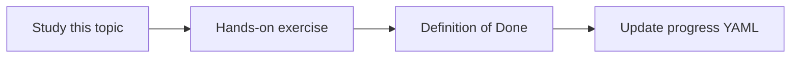

# Git integration

Topic ID: `P4-T06` · Phase: `P4` · Track: `mvp` · Default owner: `developer-b`

## What is it?

Git integration reads trees, history, and diffs for authorized repos. It is not a replacement for code owners’ access control.

## Why do we need it?

Questions about current implementation need the repo, not only Confluence.

## How does it work?

Clone or fetch with a read-only credential. Index selected paths. Record commit SHA on every chunk.

## Example in our project

atlas-inventory-service@c0ffee implements ReservationService.

The example uses the synthetic **Atlas Inventory Platform** only. Do not substitute real client systems.

## What must we learn?

- SHA provenance
- Path allowlists
- Read-only remotes

## Hands-on exercise

Index examples/synthetic-data/git and attach commit SHAs to files.

**Deliverable:** Git adapter over the synthetic repo snapshot

## Definition of Done

Done is not “the Markdown file exists.” Done means you can explain the topic, you know why it matters for the agent, the exercise (or equivalent) is complete, and all of the following are true:

- SHA on chunks
- Path filter exists
- No write remotes in design

## Resources

Official documentation only. Expand this list as you study; do not add unverified links.

- [Git documentation](https://git-scm.com/docs)

## Key Takeaways

- Cite commit SHAs
- Don’t index secrets paths
- Read-only credentials

## Related Topics

- [P4-T08](../P4/P4-T08-java-code-indexing.md)
- [P2-T08](../P2/P2-T08-keyword-search.md)
