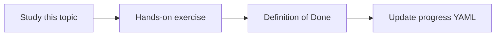

# SVN integration

Topic ID: `P4-T07` · Phase: `P4` · Track: `advanced` · Default owner: `developer-b`

## What is it?

SVN remains in some enterprises for older modules. Access is typically svn+ssh or HTTPS with service credentials.

## Why do we need it?

Atlas still has a legacy pricing module in SVN that Git does not fully replace.

## How does it work?

Prefer export of allowed paths at a revision. Record revision numbers. Do not two-way sync.

## Example in our project

svn://synthetic/atlas-pricing@r1844 contains PricingRules.xml.

The example uses the synthetic **Atlas Inventory Platform** only. Do not substitute real client systems.

## What must we learn?

- Revision numbers
- Path export
- Legacy priority

## Hands-on exercise

Write the connector page details and a fixture layout for an SVN export.

**Deliverable:** SVN connector design

## Definition of Done

Done is not “the Markdown file exists.” Done means you can explain the topic, you know why it matters for the agent, the exercise (or equivalent) is complete, and all of the following are true:

- Revision in metadata
- Priority is advanced unless needed
- Read-only

## Resources

Official documentation only. Expand this list as you study; do not add unverified links.

- [Apache Subversion](https://subversion.apache.org/)

## Key Takeaways

- Revisions are citations
- Export, don’t mount production
- Treat as second-class to Git unless required

## Related Topics

- [P4-T06](../P4/P4-T06-git-integration.md)
- [P4-T16](../P4/P4-T16-document-versioning.md)
