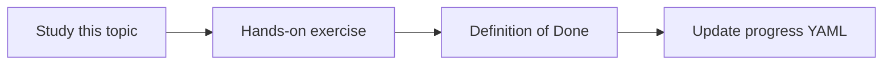

# Java code indexing

Topic ID: `P4-T08` · Phase: `P4` · Track: `mvp` · Default owner: `developer-a`

## What is it?

Code indexing pulls classes, methods, annotations, and comments into search documents—not a full compiler unless needed.

## Why do we need it?

“Where is the business rule?” is a top user question.

## How does it work?

Parse packages, class names, method names, RequestMapping paths, and Javadoc. Store file path and SHA.

## Example in our project

@PostMapping("/reservations") on ReservationController is a retrievable fact.

The example uses the synthetic **Atlas Inventory Platform** only. Do not substitute real client systems.

## What must we learn?

- Symbol extraction
- Spring annotations
- Comments as docs

## Hands-on exercise

Index the synthetic Java module and answer one mapping-to-method question via search (no LLM required).

**Deliverable:** Symbol index for synthetic Spring code

## Definition of Done

Done is not “the Markdown file exists.” Done means you can explain the topic, you know why it matters for the agent, the exercise (or equivalent) is complete, and all of the following are true:

- Symbol table exists
- HTTP mappings extracted
- SHA recorded

## Resources

Official documentation only. Expand this list as you study; do not add unverified links.

- [Git documentation](https://git-scm.com/docs)

## Key Takeaways

- Symbols beat raw file chunks for code Q&A
- Annotations are APIs
- Keep parsers simple first

## Related Topics

- [P2-T08](../P2/P2-T08-keyword-search.md)
- [P7-T06](../P7/P7-T06-code-to-requirement-mapping.md)
