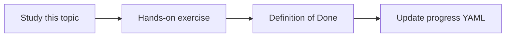

# Database schema discovery

Topic ID: `P4-T09` · Phase: `P4` · Track: `mvp` · Default owner: `developer-b`

## What is it?

Schema discovery lists databases, tables, columns, keys, and comments. It is documentation of structure.

## Why do we need it?

Data-movement questions start with tables and foreign keys.

## How does it work?

Use information_schema or vendor catalogs with a read-only role. Store comments. Do not dump fact tables.

## Example in our project

table reservation(id, order_id, ttl_minutes, status) is indexed with its comment.

The example uses the synthetic **Atlas Inventory Platform** only. Do not substitute real client systems.

## What must we learn?

- information_schema
- Comments
- No fact-table dumps

## Hands-on exercise

Parse examples/synthetic-data/sql into a schema catalog JSON.

**Deliverable:** Schema catalog from synthetic SQL

## Definition of Done

Done is not “the Markdown file exists.” Done means you can explain the topic, you know why it matters for the agent, the exercise (or equivalent) is complete, and all of the following are true:

- Tables and columns listed
- PKs/FKs listed
- No live DB required

## Resources

Official documentation only. Expand this list as you study; do not add unverified links.

- [PostgreSQL info schema](https://www.postgresql.org/docs/current/information-schema.html)

## Key Takeaways

- Schema over rows
- Comments are gold
- Read-only catalog role

## Related Topics

- [P4-T10](../P4/P4-T10-safe-read-only-sql-access.md)
- [P5-T07](../P5/P5-T07-read-only-diagnostic-tools.md)
