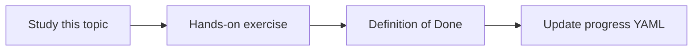

# Safe read-only SQL access

Topic ID: `P4-T10` · Phase: `P4` · Track: `advanced` · Default owner: `developer-b`

## What is it?

Live SQL is a diagnostic tool, not an open warehouse. Allowlist statements, schemas, row caps, and timeouts.

## Why do we need it?

Unconstrained SQL is data exfiltration and downtime.

## How does it work?

Default to schema-only. If queries are allowed, SELECT only, bind parameters, statement timeout, max rows, and human approval for new templates.

## Example in our project

Allowed: SELECT status, count(*) FROM reservation GROUP BY status. Forbidden: SELECT * FROM customer_pii.

The example uses the synthetic **Atlas Inventory Platform** only. Do not substitute real client systems.

## What must we learn?

- Allowlists
- Row caps
- No DDL/DML

## Hands-on exercise

Write a policy plus three allowed and three forbidden queries on synthetic schema.

**Deliverable:** SQL tool policy and allowlist

## Definition of Done

Done is not “the Markdown file exists.” Done means you can explain the topic, you know why it matters for the agent, the exercise (or equivalent) is complete, and all of the following are true:

- Policy written
- Default is schema-only for MVP
- Approval path defined

## Resources

Official documentation only. Expand this list as you study; do not add unverified links.

- [Cloud IAM](https://cloud.google.com/iam/docs)

## Key Takeaways

- Schema-only is the MVP
- Allowlist beats LLM-generated SQL
- Cap rows always

## Related Topics

- [P5-T07](../P5/P5-T07-read-only-diagnostic-tools.md)
- [P6-T13](../P6/P6-T13-human-approval-for-risky-actions.md)
