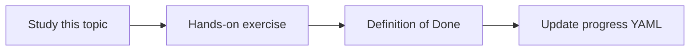

# Kafka schema and event inspection

Topic ID: `P4-T11` · Phase: `P4` · Track: `mvp` · Default owner: `developer-b`

## What is it?

Kafka knowledge includes topic names, partitions (as metadata), and Avro/JSON schemas. Live consumption is a separate, higher-risk mode.

## Why do we need it?

Data-movement questions need event contracts more than replayed payloads.

## How does it work?

Read Schema Registry or checked-in .avsc files. Document why MVP does not run a consumer group against production.

## Example in our project

topic inventory.reserved schema ReservationEvent v4 is citable. Replaying customer payloads is out of scope.

The example uses the synthetic **Atlas Inventory Platform** only. Do not substitute real client systems.

## What must we learn?

- Topics vs payloads
- Schema Registry
- No prod consumer

## Hands-on exercise

Index synthetic Avro/JSON schemas and list topics in a catalog.

**Deliverable:** Kafka metadata fixture and connector design

## Definition of Done

Done is not “the Markdown file exists.” Done means you can explain the topic, you know why it matters for the agent, the exercise (or equivalent) is complete, and all of the following are true:

- Schema files indexed
- Live consume marked non-goal
- Provenance includes schema version

## Resources

Official documentation only. Expand this list as you study; do not add unverified links.

- [Apache Kafka docs](https://kafka.apache.org/documentation/)

## Key Takeaways

- Contracts over payloads
- Schema versions are citations
- Don’t silently become a consumer

## Related Topics

- [P0-T02](../P0/P0-T02-scope-and-non-goals.md)
- [P5-T13](../P5/P5-T13-cross-source-question-answering.md)
