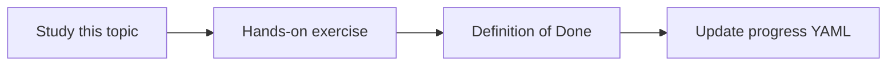

# REST API integration

Topic ID: `P4-T12` · Phase: `P4` · Track: `mvp` · Default owner: `developer-b`

## What is it?

REST knowledge is primarily OpenAPI: paths, operations, schemas. Live GET probes are optional and must be allowlisted.

## Why do we need it?

Users ask which API updates reservations.

## How does it work?

Parse OpenAPI documents into operations with operationId, path, and auth scheme. No anonymous crawling of production.

## Example in our project

POST /reservations in atlas-inventory.yaml maps to ReservationController.

The example uses the synthetic **Atlas Inventory Platform** only. Do not substitute real client systems.

## What must we learn?

- OpenAPI parsing
- operationId
- Allowlisted live GET (later)

## Hands-on exercise

Index the synthetic OpenAPI file into an operation catalog.

**Deliverable:** OpenAPI catalog from synthetic specs

## Definition of Done

Done is not “the Markdown file exists.” Done means you can explain the topic, you know why it matters for the agent, the exercise (or equivalent) is complete, and all of the following are true:

- Operations listed
- Live GET optional/advanced
- Auth schemes recorded

## Resources

Official documentation only. Expand this list as you study; do not add unverified links.

- [OpenAPI Specification](https://spec.openapis.org/oas/latest.html)

## Key Takeaways

- Specs are the source of truth
- Don’t spider production
- Map API to code later

## Related Topics

- [P4-T08](../P4/P4-T08-java-code-indexing.md)
- [P7-T07](../P7/P7-T07-architecture-dependency-analysis.md)
