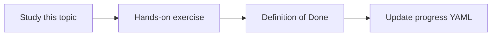

# Shared-drive synchronization

Topic ID: `P4-T13` · Phase: `P4` · Track: `mvp` · Default owner: `developer-b`

## What is it?

Shared drives hold PDFs and spreadsheets. Sync only allowlisted folders with a service identity.

## Why do we need it?

Unscoped file shares are a classic over-collection path.

## How does it work?

List files, hash, download new/changed, propagate deletes. Record path and ACL groups from the share if available.

## Example in our project

\\atlas-files\architecture\approved is in; \\atlas-files\hr is out.

The example uses the synthetic **Atlas Inventory Platform** only. Do not substitute real client systems.

## What must we learn?

- Folder allowlist
- Hash sync
- ACL from store

## Hands-on exercise

Simulate sync over a local folder of synthetic PDFs including a deletion.

**Deliverable:** Folder allowlist and hash-sync design

## Definition of Done

Done is not “the Markdown file exists.” Done means you can explain the topic, you know why it matters for the agent, the exercise (or equivalent) is complete, and all of the following are true:

- Allowlist documented
- Delete simulated
- No real corporate mount used

## Resources

Official documentation only. Expand this list as you study; do not add unverified links.

- [Cloud Storage](https://cloud.google.com/storage/docs)

## Key Takeaways

- Allowlist folders
- Hashes drive incremental
- HR drives stay out

## Related Topics

- [P4-T18](../P4/P4-T18-deletion-propagation.md)
- [P4-T19](../P4/P4-T19-source-access-permissions.md)
