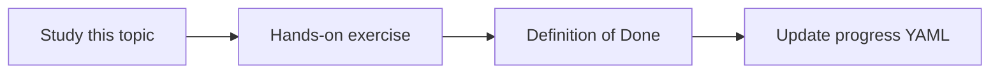

# Microsoft Graph and Teams transcripts

Topic ID: `P4-T14` · Phase: `P4` · Track: `mvp` · Default owner: `developer-a`

## What is it?

Teams knowledge includes meeting metadata, attendees, transcripts, speaker attribution, and timestamps. Graph permissions are explicit and must be approved.

## Why do we need it?

Decisions often live in meetings, not wikis. This is a privacy-sensitive source.

## How does it work?

Use Microsoft Graph online meeting and transcript APIs as documented. Request only needed application or delegated permissions. Store speaker labels and times.

## Example in our project

Meeting “AIP reservation review 2026-03-12” transcript line 00:12:04 Speaker: Jordan — “TTL stays 15 minutes.”

The example uses the synthetic **Atlas Inventory Platform** only. Do not substitute real client systems.

## What must we learn?

- Graph permissions
- Transcript vs recording
- Speaker + timestamp

## Hands-on exercise

Map required Graph permissions and build a synthetic transcript fixture with speakers and times.

**Deliverable:** Teams connector design covering Graph permissions

## Definition of Done

Done is not “the Markdown file exists.” Done means you can explain the topic, you know why it matters for the agent, the exercise (or equivalent) is complete, and all of the following are true:

- Permission list written
- Synthetic transcript ingested in design
- No tenant is contacted

## Resources

Official documentation only. Expand this list as you study; do not add unverified links.

- [Microsoft Graph overview](https://learn.microsoft.com/en-us/graph/overview)
- [Graph onlineMeeting](https://learn.microsoft.com/en-us/graph/api/resources/onlinemeeting?view=graph-rest-1.0)

## Key Takeaways

- Least Graph scopes
- Transcripts first, recordings later
- Attribution is required

## Related Topics

- [P4-T15](../P4/P4-T15-recording-transcription-considerations.md)
- [P7-T01](../P7/P7-T01-meeting-transcript-intelligence.md)
