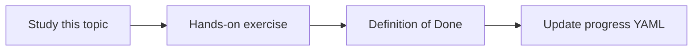

# Recording transcription considerations

Topic ID: `P4-T15` · Phase: `P4` · Track: `advanced` · Default owner: `developer-a`

## What is it?

Recordings may contain extra attendees, side talk, and higher retention risk. Transcription, if allowed, needs an approved pipeline.

## Why do we need it?

Legal and privacy reviews often allow transcripts but restrict recording storage.

## How does it work?

Prefer vendor-provided transcripts. If transcribing audio, document consent, retention, storage region, and access. Default is do-not-ingest recordings.

## Example in our project

Atlas policy example: approved transcripts only; recordings remain in Teams with no copy into the agent bucket.

The example uses the synthetic **Atlas Inventory Platform** only. Do not substitute real client systems.

## What must we learn?

- Consent
- Retention
- Default deny recordings

## Hands-on exercise

Write a decision table: transcript / recording / neither for MVP.

**Deliverable:** Recording policy in the Teams connector doc

## Definition of Done

Done is not “the Markdown file exists.” Done means you can explain the topic, you know why it matters for the agent, the exercise (or equivalent) is complete, and all of the following are true:

- Default deny recordings
- Consent noted
- Storage location noted

## Resources

Official documentation only. Expand this list as you study; do not add unverified links.

- [Graph onlineMeeting](https://learn.microsoft.com/en-us/graph/api/resources/onlinemeeting?view=graph-rest-1.0)
- [Microsoft Graph overview](https://learn.microsoft.com/en-us/graph/overview)

## Key Takeaways

- Transcripts ≠ recordings
- Default deny audio copies
- Need explicit approval

## Related Topics

- [P6-T12](../P6/P6-T12-data-retention.md)
- [P7-T01](../P7/P7-T01-meeting-transcript-intelligence.md)
