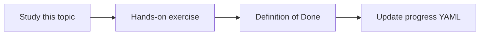

# Document versioning

Topic ID: `P4-T16` · Phase: `P4` · Track: `mvp` · Default owner: `developer-b`

## What is it?

Versioning records page version, Git SHA, SVN revision, schema version, or file hash.

## Why do we need it?

Citations without versions cannot be audited later.

## How does it work?

Define a version tuple per source type. Never overwrite raw objects; write new versions.

## Example in our project

Confluence version 12 and Git SHA c0ffee can both describe reservation TTL and must both be stored.

The example uses the synthetic **Atlas Inventory Platform** only. Do not substitute real client systems.

## What must we learn?

- Per-source version keys
- Immutable raw
- Citation versions

## Hands-on exercise

Add version fields to the adapter contract and fixtures.

**Deliverable:** Version fields in SourceDocument

## Definition of Done

Done is not “the Markdown file exists.” Done means you can explain the topic, you know why it matters for the agent, the exercise (or equivalent) is complete, and all of the following are true:

- Fields exist
- Raw objects not overwritten in design
- Citations include version

## Resources

Official documentation only. Expand this list as you study; do not add unverified links.

- [Confluence REST v2](https://developer.atlassian.com/cloud/confluence/rest/v2/intro/)
- [Git documentation](https://git-scm.com/docs)

## Key Takeaways

- Version everything
- Don’t clobber raw
- Users see versions

## Related Topics

- [P2-T15](../P2/P2-T15-knowledge-freshness.md)
- [P7-T10](../P7/P7-T10-temporal-knowledge-and-superseded-decisions.md)
