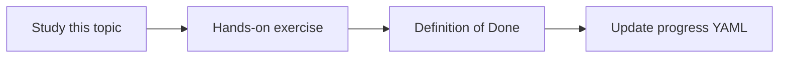

# Deduplication

Topic ID: `P4-T17` · Phase: `P4` · Track: `mvp` · Default owner: `developer-b`

## What is it?

Dedup uses cryptographic hashes for exact copies and optional fuzzy methods for near copies.

## Why do we need it?

The same PDF in Git and a shared drive should not double-cite as two truths.

## How does it work?

Exact hash first. Record aliases (multiple URIs, one content_id). Fuzzy dedup is advanced.

## Example in our project

reservation-v3.pdf in Drive and in Git share content_id=sha256:… with two URIs.

The example uses the synthetic **Atlas Inventory Platform** only. Do not substitute real client systems.

## What must we learn?

- content_id
- URI aliases
- Fuzzy later

## Hands-on exercise

Demonstrate two synthetic files with identical bytes mapping to one content_id.

**Deliverable:** Hash-based dedup design

## Definition of Done

Done is not “the Markdown file exists.” Done means you can explain the topic, you know why it matters for the agent, the exercise (or equivalent) is complete, and all of the following are true:

- Hash dedup specified
- Aliases preserved
- Fuzzy marked advanced

## Resources

Official documentation only. Expand this list as you study; do not add unverified links.

- [Cloud Storage](https://cloud.google.com/storage/docs)

## Key Takeaways

- Hash first
- Keep all URIs
- Don’t drop provenance when merging

## Related Topics

- [P2-T12](../P2/P2-T12-context-assembly.md)
- [P4-T18](../P4/P4-T18-deletion-propagation.md)
