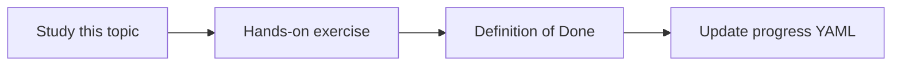

# Deletion propagation

Topic ID: `P4-T18` · Phase: `P4` · Track: `mvp` · Default owner: `developer-b`

## What is it?

When a source deletes or revokes access, derived chunks must disappear from retrieval. Tombstones help catch missed deletes.

## Why do we need it?

Forgotten chunks are a compliance failure.

## How does it work?

On delete: remove parsed objects, index vectors, and cache. Log the deletion. Periodic reconcile against source listings.

## Example in our project

If Confluence page Reservation Draft is deleted, /ask must not cite it the next day.

The example uses the synthetic **Atlas Inventory Platform** only. Do not substitute real client systems.

## What must we learn?

- Tombstones
- Reconcile jobs
- Cache invalidation

## Hands-on exercise

Simulate a delete in the fake adapter and show the chunk is gone.

**Deliverable:** Tombstone behavior in the pipeline

## Definition of Done

Done is not “the Markdown file exists.” Done means you can explain the topic, you know why it matters for the agent, the exercise (or equivalent) is complete, and all of the following are true:

- Delete path documented
- Reconcile mentioned
- Serving cache considered

## Resources

Official documentation only. Expand this list as you study; do not add unverified links.

- [Cloud Storage](https://cloud.google.com/storage/docs)

## Key Takeaways

- Deletes are features
- Reconcile periodically
- Caches must obey deletes

## Related Topics

- [P6-T12](../P6/P6-T12-data-retention.md)
- [P4-T19](../P4/P4-T19-source-access-permissions.md)
