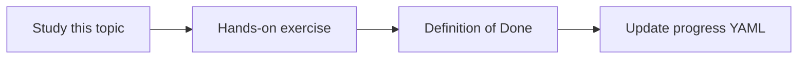

# Source access permissions

Topic ID: `P4-T19` · Phase: `P4` · Track: `mvp` · Default owner: `developer-b`

## What is it?

Permissions at the source (space, repo, folder, meeting) must be preserved as metadata and enforced at retrieve time.

## Why do we need it?

Indexing without ACL is equivalent to making every reader an admin.

## How does it work?

Model principals and groups. Default deny. If a source ACL cannot be read, do not ingest.

## Example in our project

Confluence space AIP-HR is omitted because the ingest identity cannot list it—or is ingested with group=hr-only in a secure test fixture.

The example uses the synthetic **Atlas Inventory Platform** only. Do not substitute real client systems.

## What must we learn?

- Default deny
- Skip if ACL unknown
- Retrieve-time enforce

## Hands-on exercise

Define the ACL fields and a fixture with two groups.

**Deliverable:** ACL model on chunks

## Definition of Done

Done is not “the Markdown file exists.” Done means you can explain the topic, you know why it matters for the agent, the exercise (or equivalent) is complete, and all of the following are true:

- ACL fields specified
- Unknown ACL = skip
- Retrieve filter specified

## Resources

Official documentation only. Expand this list as you study; do not add unverified links.

- [Cloud IAM](https://cloud.google.com/iam/docs)

## Key Takeaways

- No ACL, no ingest
- Enforce at retrieve
- Ingest identity ≠ user identity

## Related Topics

- [P6-T07](../P6/P6-T07-permission-aware-retrieval.md)
- [P2-T10](../P2/P2-T10-metadata-filtering.md)
