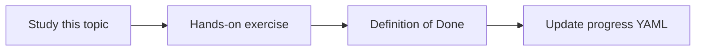

# Indexing and reindexing

Topic ID: `P4-T20` · Phase: `P4` · Track: `mvp` · Default owner: `developer-b`

## What is it?

Reindexing writes a new index snapshot then atomically points serving at it. Failures leave the previous snapshot live.

## Why do we need it?

A half-built index looks like “the architecture disappeared.”

## How does it work?

Version index snapshots. Health-check retrieval before swap. Keep N previous snapshots.

## Example in our project

index-2026-04-01 succeeds checks, then Cloud Run reads the new snapshot pointer.

The example uses the synthetic **Atlas Inventory Platform** only. Do not substitute real client systems.

## What must we learn?

- Snapshot versions
- Atomic pointer
- Rollback snapshots

## Hands-on exercise

Write the swap procedure including a failed-build case.

**Deliverable:** Blue/green index swap design

## Definition of Done

Done is not “the Markdown file exists.” Done means you can explain the topic, you know why it matters for the agent, the exercise (or equivalent) is complete, and all of the following are true:

- Snapshot layout defined
- Swap is atomic in design
- Rollback described

## Resources

Official documentation only. Expand this list as you study; do not add unverified links.

- [Cloud Storage](https://cloud.google.com/storage/docs)
- [Cloud Run docs](https://cloud.google.com/run/docs)

## Key Takeaways

- Never serve a half index
- Keep previous snapshots
- Health-check before swap

## Related Topics

- [P8-T10](../P8/P8-T10-deployment-and-rollback.md)
- [P8-T09](../P8/P8-T09-connector-health-monitoring.md)
