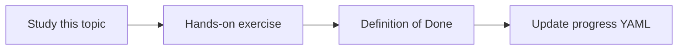

# Agent execution lifecycle

Topic ID: `P5-T01` · Phase: `P5` · Track: `mvp` · Default owner: `developer-a`

## What is it?

Lifecycle: authorize, assemble session, plan, call tools, generate, validate, log. Each step can fail closed.

## Why do we need it?

Most production bugs are lifecycle bugs (skipped validation, missing logs), not model choice.

## How does it work?

Document the state machine and timeouts per step.

## Example in our project

Ask “who consumes inventory.reserved?” → retrieve → lookup_symbol → structured answer → audit log.

The example uses the synthetic **Atlas Inventory Platform** only. Do not substitute real client systems.

## What must we learn?

- Authorize first
- Validate before return
- Fail closed

## Hands-on exercise

Draw the sequence including a tool error path.

**Deliverable:** Lifecycle sequence diagram

## Definition of Done

Done is not “the Markdown file exists.” Done means you can explain the topic, you know why it matters for the agent, the exercise (or equivalent) is complete, and all of the following are true:

- Diagram exists
- Error path included
- Matches ADK mental model

## Resources

Official documentation only. Expand this list as you study; do not add unverified links.

- [Google ADK](https://adk.dev/)

## Key Takeaways

- Authn/z first
- Validation last
- Every step has a timeout

## Related Topics

- [P5-T11](../P5/P5-T11-error-handling.md)
- [P5-T12](../P5/P5-T12-timeouts-and-retries.md)
