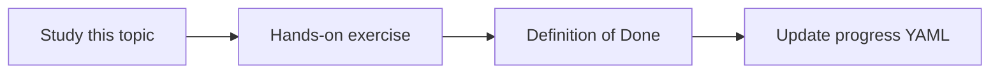

# Tool selection

Topic ID: `P5-T02` · Phase: `P5` · Track: `mvp` · Default owner: `developer-a`

## What is it?

Selection uses tool descriptions, system policy, and sometimes explicit routers. Too many overlapping tools cause thrash.

## Why do we need it?

Wrong tool selection retrieves a PDF when the user asked for a Kafka schema.

## How does it work?

Keep a small tool catalog. Write distinct descriptions. Add policy: code questions should call lookup_symbol.

## Example in our project

“What fields are on ReservationEvent?” → kafka_schema tool, not PDF search.

The example uses the synthetic **Atlas Inventory Platform** only. Do not substitute real client systems.

## What must we learn?

- Catalog size
- Description distinctness
- Policy hints

## Hands-on exercise

Write 8 questions and the expected first tool.

**Deliverable:** Tool-routing examples

## Definition of Done

Done is not “the Markdown file exists.” Done means you can explain the topic, you know why it matters for the agent, the exercise (or equivalent) is complete, and all of the following are true:

- Expected-tool table exists
- Catalog stays small
- Overlaps noted

## Resources

Official documentation only. Expand this list as you study; do not add unverified links.

- [Google ADK](https://adk.dev/)

## Key Takeaways

- Fewer, clearer tools
- Descriptions are routing
- Measure mis-routes later

## Related Topics

- [P5-T06](../P5/P5-T06-query-planning.md)
- [P6-T06](../P6/P6-T06-regression-testing.md)
