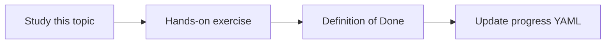

# Tool schemas

Topic ID: `P5-T03` · Phase: `P5` · Track: `mvp` · Default owner: `developer-a`

## What is it?

Schemas tell the model which arguments exist and their types. Loose schemas produce unexecutable calls.

## Why do we need it?

A retrieve tool with a free-form “anything” parameter is an injection magnet.

## How does it work?

Use enums where possible, max lengths, and required fields. Reject extras.

## Example in our project

retrieve_chunks(query: string, source_type?: enum, k?: 1-8).

The example uses the synthetic **Atlas Inventory Platform** only. Do not substitute real client systems.

## What must we learn?

- JSON Schema
- Enums
- Reject extras

## Hands-on exercise

Write schemas for retrieve, lookup_symbol, and lookup_schema.

**Deliverable:** JSON schemas for MVP tools

## Definition of Done

Done is not “the Markdown file exists.” Done means you can explain the topic, you know why it matters for the agent, the exercise (or equivalent) is complete, and all of the following are true:

- Three schemas written
- Max lengths set
- Validation tests planned

## Resources

Official documentation only. Expand this list as you study; do not add unverified links.

- [ADK Python quickstart](https://adk.dev/get-started/python/)

## Key Takeaways

- Tight schemas
- Enums beat free text
- Validate in code too

## Related Topics

- [P1-T07](../P1/P1-T07-structured-outputs.md)
- [P6-T09](../P6/P6-T09-prompt-injection-defenses.md)
