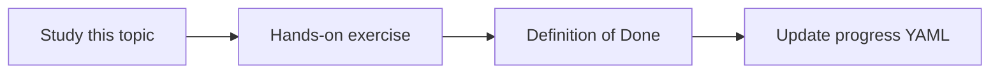

# Multi-step reasoning

Topic ID: `P5-T05` · Phase: `P5` · Track: `mvp` · Default owner: `developer-a`

## What is it?

Many Atlas questions need two hops: find the API, then the Java method. Unlimited hops loop and cost money.

## Why do we need it?

Cross-source questions are the product. Unbounded ReAct loops are an incident.

## How does it work?

Set max tool hops. After the cap, answer with what is known or decline.

## Example in our project

Hop 1 retrieve OpenAPI POST /reservations; hop 2 lookup_symbol ReservationController.

The example uses the synthetic **Atlas Inventory Platform** only. Do not substitute real client systems.

## What must we learn?

- Hop limits
- Stop conditions
- Partial answers

## Hands-on exercise

Demo a 2-hop success and a 3rd-hop stop.

**Deliverable:** Max-hop policy and a 2-step demo

## Definition of Done

Done is not “the Markdown file exists.” Done means you can explain the topic, you know why it matters for the agent, the exercise (or equivalent) is complete, and all of the following are true:

- Max hops configured
- Demo recorded
- Partial answer policy written

## Resources

Official documentation only. Expand this list as you study; do not add unverified links.

- [Google ADK](https://adk.dev/)

## Key Takeaways

- Cap hops
- Partial is OK
- Loops are bugs

## Related Topics

- [P5-T06](../P5/P5-T06-query-planning.md)
- [P5-T13](../P5/P5-T13-cross-source-question-answering.md)
