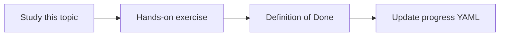

# Query planning

Topic ID: `P5-T06` · Phase: `P5` · Track: `advanced` · Default owner: `developer-a`

## What is it?

Planning restates the user question as sub-queries per source type before calling tools.

## Why do we need it?

A single embedding query is weak for “how does data move from DB to Kafka to API?”

## How does it work?

Start with heuristic plans (if question mentions Kafka, call schema tool). LLM planners are optional.

## Example in our project

Plan: schema reservation table → topic inventory.reserved → REST GET /reservations/{id}.

The example uses the synthetic **Atlas Inventory Platform** only. Do not substitute real client systems.

## What must we learn?

- Sub-queries
- Heuristic vs LLM plan
- Plan traces

## Hands-on exercise

Write plans for five cross-source golden questions.

**Deliverable:** Planner examples for cross-source questions

## Definition of Done

Done is not “the Markdown file exists.” Done means you can explain the topic, you know why it matters for the agent, the exercise (or equivalent) is complete, and all of the following are true:

- Five plans written
- Heuristic default for MVP
- Plans logged

## Resources

Official documentation only. Expand this list as you study; do not add unverified links.

- [Google ADK](https://adk.dev/)

## Key Takeaways

- Plan then retrieve
- Heuristics first
- Log the plan

## Related Topics

- [P5-T13](../P5/P5-T13-cross-source-question-answering.md)
- [P7-T07](../P7/P7-T07-architecture-dependency-analysis.md)
