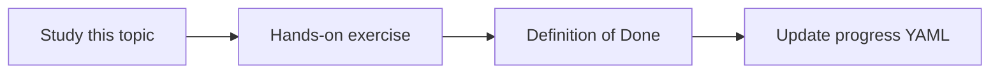

# Read-only diagnostic tools

Topic ID: `P5-T07` · Phase: `P5` · Track: `mvp` · Default owner: `developer-a`

## What is it?

Diagnostic tools inspect indexes, schemas, and metadata. They never publish events, write tickets, or DDL.

## Why do we need it?

Users will eventually ask the agent to “just fix it.” Tools must make that impossible.

## How does it work?

Name tools with get_/lookup_/search_. Enforce in code, not just prompts.

## Example in our project

get_topic_schema(name) is allowed. publish_event is not implemented.

The example uses the synthetic **Atlas Inventory Platform** only. Do not substitute real client systems.

## What must we learn?

- Naming
- Code-level deny writes
- User-visible capability list

## Hands-on exercise

Publish a capability list in docs and assert no write tools exist in the skeleton.

**Deliverable:** Diagnostic tool list

## Definition of Done

Done is not “the Markdown file exists.” Done means you can explain the topic, you know why it matters for the agent, the exercise (or equivalent) is complete, and all of the following are true:

- Capability list exists
- No write tools in code
- Prompt restates read-only

## Resources

Official documentation only. Expand this list as you study; do not add unverified links.

- [Google ADK](https://adk.dev/)
- [Cloud IAM](https://cloud.google.com/iam/docs)

## Key Takeaways

- Read-only in code
- Naming reveals intent
- Publish capabilities

## Related Topics

- [P6-T13](../P6/P6-T13-human-approval-for-risky-actions.md)
- [P0-T02](../P0/P0-T02-scope-and-non-goals.md)
