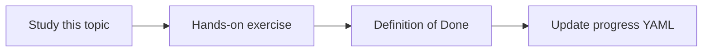

# MCP fundamentals

Topic ID: `P5-T08` · Phase: `P5` · Track: `advanced` · Default owner: `developer-a`

## What is it?

MCP is an open protocol for exposing tools and resources to models. ADK tools may remain in-process for MVP.

## Why do we need it?

We should not build a mesh of MCP servers before a single in-process agent works.

## How does it work?

Read official MCP overview. Decide in an ADR whether MCP is later integration, not MVP.

## Example in our project

A future Confluence MCP server could replace our adapter’s tool surface, still behind the same ACLs.

The example uses the synthetic **Atlas Inventory Platform** only. Do not substitute real client systems.

## What must we learn?

- MCP hosts vs servers
- Why not MVP
- ACL still applies

## Hands-on exercise

Write a short ADR comment: MCP deferred until in-process tools are stable.

**Deliverable:** MCP applicability note

## Definition of Done

Done is not “the Markdown file exists.” Done means you can explain the topic, you know why it matters for the agent, the exercise (or equivalent) is complete, and all of the following are true:

- Note exists
- MVP remains in-process tools
- Security warning recorded

## Resources

Official documentation only. Expand this list as you study; do not add unverified links.

- [Model Context Protocol](https://modelcontextprotocol.io/)

## Key Takeaways

- MCP is optional later
- Protocol ≠ permission
- Don’t multiply runtimes early

## Related Topics

- [P5-T14](../P5/P5-T14-when-multi-agent-systems-are-appropriate.md)
- [P3-T04](../P3/P3-T04-google-adk.md)
