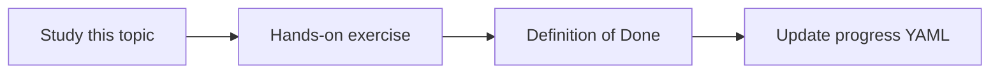

# Agent state and memory

Topic ID: `P5-T09` · Phase: `P5` · Track: `mvp` · Default owner: `developer-a`

## What is it?

Short-term memory is session context. Durable knowledge belongs in the index, not in hidden agent memory blobs.

## Why do we need it?

Storing “facts” in memory duplicates the index without ACLs or citations.

## How does it work?

Allow session summaries. Forbid long-term memory of source documents. Re-retrieve instead of remembering.

## Example in our project

If the user asked about TTL yesterday, re-retrieve reservation-v3 rather than trusting a remembered number.

The example uses the synthetic **Atlas Inventory Platform** only. Do not substitute real client systems.

## What must we learn?

- Session summary
- No shadow knowledge base
- Re-retrieve

## Hands-on exercise

Write allowed/forbidden memory contents.

**Deliverable:** Memory policy

## Definition of Done

Done is not “the Markdown file exists.” Done means you can explain the topic, you know why it matters for the agent, the exercise (or equivalent) is complete, and all of the following are true:

- Policy exists
- Index remains the knowledge store
- Summaries have TTL

## Resources

Official documentation only. Expand this list as you study; do not add unverified links.

- [Google ADK](https://adk.dev/)

## Key Takeaways

- Index is memory of record
- Sessions are ephemeral
- Re-retrieve facts

## Related Topics

- [P5-T10](../P5/P5-T10-conversation-context.md)
- [P6-T12](../P6/P6-T12-data-retention.md)
