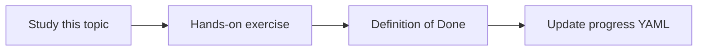

# Conversation context

Topic ID: `P5-T10` · Phase: `P5` · Track: `mvp` · Default owner: `developer-a`

## What is it?

Follow-ups like “which class is that?” need referenced entities from the prior cited answer.

## Why do we need it?

Naive history stuffing drops sources or lets users jailbreak via prior turns.

## How does it work?

Store structured entities (last citations, last symbols) separately from raw chat. Re-ground each answer.

## Example in our project

Turn 1 cites ReservationService. Turn 2 “show the method” calls lookup_symbol with that class.

The example uses the synthetic **Atlas Inventory Platform** only. Do not substitute real client systems.

## What must we learn?

- Entity carry-forward
- Re-ground every turn
- History budget

## Hands-on exercise

Specify how three follow-up types resolve (that, the topic, the table).

**Deliverable:** Follow-up handling examples

## Definition of Done

Done is not “the Markdown file exists.” Done means you can explain the topic, you know why it matters for the agent, the exercise (or equivalent) is complete, and all of the following are true:

- Entity store specified
- Each turn still cites
- History budget set

## Resources

Official documentation only. Expand this list as you study; do not add unverified links.

- [Gemini prompting](https://ai.google.dev/gemini-api/docs/prompting-strategies)

## Key Takeaways

- Structure the follow-up state
- Cite every turn
- Don’t trust raw history as evidence

## Related Topics

- [P1-T02](../P1/P1-T02-tokens-and-context-windows.md)
- [P6-T09](../P6/P6-T09-prompt-injection-defenses.md)
