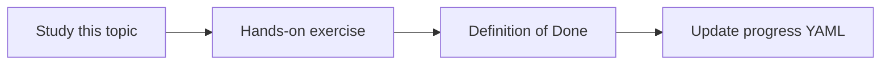

# Error handling

Topic ID: `P5-T11` · Phase: `P5` · Track: `mvp` · Default owner: `developer-a`

## What is it?

Errors include authz deny, empty retrieval, tool timeout, invalid JSON, and upstream 429. Users get safe messages; logs get detail.

## Why do we need it?

Stack traces in answers leak internals. Silent retries hide outages.

## How does it work?

Classify errors. User text is generic. Metrics increment. No secret in error strings.

## Example in our project

Empty retrieval → “I could not find authorized sources for that.” Log contains query hash and retriever stats.

The example uses the synthetic **Atlas Inventory Platform** only. Do not substitute real client systems.

## What must we learn?

- Error classes
- User vs log
- No leakage

## Hands-on exercise

Write the catalog with user message and log fields per class.

**Deliverable:** Error catalog

## Definition of Done

Done is not “the Markdown file exists.” Done means you can explain the topic, you know why it matters for the agent, the exercise (or equivalent) is complete, and all of the following are true:

- Catalog exists
- Deny vs empty distinguished
- No stack traces to users

## Resources

Official documentation only. Expand this list as you study; do not add unverified links.

- [Cloud Logging](https://cloud.google.com/logging/docs)

## Key Takeaways

- Classify errors
- Safe user text
- Logs are detailed

## Related Topics

- [P5-T12](../P5/P5-T12-timeouts-and-retries.md)
- [P6-T15](../P6/P6-T15-failure-recovery.md)
