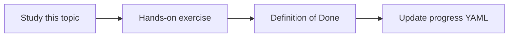

# Timeouts and retries

Topic ID: `P5-T12` · Phase: `P5` · Track: `mvp` · Default owner: `developer-b`

## What is it?

Each tool and model call has a timeout. Retries use jitter and only for idempotent reads.

## Why do we need it?

Retry storms amplify outages and cost.

## How does it work?

Set per-call timeouts, overall request deadline, max retries, and retryable error codes.

## Example in our project

Gemini 429 may retry twice; a 403 from Graph does not.

The example uses the synthetic **Atlas Inventory Platform** only. Do not substitute real client systems.

## What must we learn?

- Deadlines
- Idempotent retries
- Jitter

## Hands-on exercise

Document timeouts for model, retrieve, and Graph/Git style tools.

**Deliverable:** Timeout and retry policy

## Definition of Done

Done is not “the Markdown file exists.” Done means you can explain the topic, you know why it matters for the agent, the exercise (or equivalent) is complete, and all of the following are true:

- Policy exists
- Overall deadline set
- Non-idempotent retries forbidden

## Resources

Official documentation only. Expand this list as you study; do not add unverified links.

- [Cloud Run docs](https://cloud.google.com/run/docs)

## Key Takeaways

- Always have a deadline
- Retry reads, not unknown writes
- Jitter

## Related Topics

- [P6-T14](../P6/P6-T14-cost-and-latency-measurement.md)
- [P6-T15](../P6/P6-T15-failure-recovery.md)
