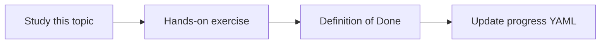

# Cross-source question answering

Topic ID: `P5-T13` · Phase: `P5` · Track: `mvp` · Default owner: `developer-a`

## What is it?

Cross-source QA is the core product: docs + code, schema + events, meetings + ADRs.

## Why do we need it?

Single-index search cannot explain data movement by itself.

## How does it work?

Use planning, hybrid retrieval, and structured citations grouped by source type. State conflicts explicitly.

## Example in our project

“How does a reservation get to Kafka?” cites SQL table, producer class, and topic schema.

The example uses the synthetic **Atlas Inventory Platform** only. Do not substitute real client systems.

## What must we learn?

- Multi-cite answers
- Conflict surfacing
- Grouped sources

## Hands-on exercise

Run three synthetic questions spanning code+docs, db+kafka, and meeting+design.

**Deliverable:** Three cross-source demos on synthetic data

## Definition of Done

Done is not “the Markdown file exists.” Done means you can explain the topic, you know why it matters for the agent, the exercise (or equivalent) is complete, and all of the following are true:

- Three demos
- Citations from ≥2 sources each
- Conflicts called out if present

## Resources

Official documentation only. Expand this list as you study; do not add unverified links.

- [Google ADK](https://adk.dev/)
- [Vertex AI generative AI](https://cloud.google.com/vertex-ai/generative-ai/docs)

## Key Takeaways

- This is the product
- Group citations
- Say when sources disagree

## Related Topics

- [P7-T09](../P7/P7-T09-contradiction-detection.md)
- [P2-T13](../P2/P2-T13-source-citations.md)
