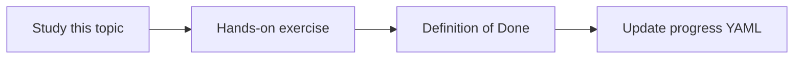

# Groundedness

Topic ID: `P6-T01` · Phase: `P6` · Track: `mvp` · Default owner: `developer-a`

## What is it?

Groundedness means each claim is entailed by the cited text. Uncited true facts still fail the rubric for this product.

## Why do we need it?

Users must be able to click a citation and see the support.

## How does it work?

Rubric: supported, partially supported, unsupported. Score golden answers regularly.

## Example in our project

Claim “TTL is 15 minutes” supported by reservation-v3 p.4. Claim “TTL is 30” unsupported.

The example uses the synthetic **Atlas Inventory Platform** only. Do not substitute real client systems.

## What must we learn?

- Entailment rubric
- Claim splitting
- Unsupported labels

## Hands-on exercise

Annotate 10 synthetic answers with the rubric.

**Deliverable:** Groundedness rubric and 10 scored answers

## Definition of Done

Done is not “the Markdown file exists.” Done means you can explain the topic, you know why it matters for the agent, the exercise (or equivalent) is complete, and all of the following are true:

- Rubric exists
- 10 annotations committed
- Unsupported answers fail CI later

## Resources

Official documentation only. Expand this list as you study; do not add unverified links.

- [Vertex AI generative AI](https://cloud.google.com/vertex-ai/generative-ai/docs)

## Key Takeaways

- Cite and support
- Split claims
- True but uncited is still a fail

## Related Topics

- [P6-T02](../P6/P6-T02-faithfulness-and-answer-correctness.md)
- [P6-T05](../P6/P6-T05-golden-questions.md)
