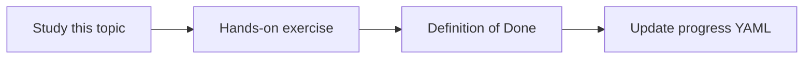

# Faithfulness and answer correctness

Topic ID: `P6-T02` · Phase: `P6` · Track: `mvp` · Default owner: `developer-a`

## What is it?

Faithfulness is consistency with retrieved text. Correctness is consistency with labeled gold. They diverge when retrieval is wrong.

## Why do we need it?

A faithful answer over stale docs can still be operationally wrong.

## How does it work?

Report both scores. Investigate retrieval when faithful-but-incorrect.

## Example in our project

Faithful to v2 TTL=30 but gold is v3 TTL=15 → retrieval freshness bug.

The example uses the synthetic **Atlas Inventory Platform** only. Do not substitute real client systems.

## What must we learn?

- Faithfulness
- Correctness
- Error attribution

## Hands-on exercise

Create two answers that split the two scores and document the bug class.

**Deliverable:** Two-score eval sheet

## Definition of Done

Done is not “the Markdown file exists.” Done means you can explain the topic, you know why it matters for the agent, the exercise (or equivalent) is complete, and all of the following are true:

- Both scores defined
- Examples of divergence exist
- Attribution rules written

## Resources

Official documentation only. Expand this list as you study; do not add unverified links.

- [Vertex AI generative AI](https://cloud.google.com/vertex-ai/generative-ai/docs)

## Key Takeaways

- Two scores
- Attribute the error
- Freshness affects correctness

## Related Topics

- [P2-T15](../P2/P2-T15-knowledge-freshness.md)
- [P6-T03](../P6/P6-T03-retrieval-quality.md)
