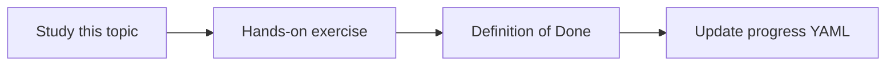

# Retrieval quality

Topic ID: `P6-T03` · Phase: `P6` · Track: `mvp` · Default owner: `developer-a`

## What is it?

Retrieval quality is independent of prose quality. Junk in the top-k poisons even a good prompt.

## Why do we need it?

Generation eval without retrieval eval leads to prompt thrash.

## How does it work?

Track hit-rate@k, MRR, and fraction of forbidden-ACL leaks in tests.

## Example in our project

hit-rate@5 = 0.8 on 20 gold queries; one leak of hr-only chunk is a sev-1 test fail.

The example uses the synthetic **Atlas Inventory Platform** only. Do not substitute real client systems.

## What must we learn?

- hit-rate@k
- MRR
- Leak tests

## Hands-on exercise

Compute hit-rate@5 on the golden set after a retriever change.

**Deliverable:** Retrieval dashboard fields (even if a sheet)

## Definition of Done

Done is not “the Markdown file exists.” Done means you can explain the topic, you know why it matters for the agent, the exercise (or equivalent) is complete, and all of the following are true:

- Metrics computed
- Leak test defined
- Results stored

## Resources

Official documentation only. Expand this list as you study; do not add unverified links.

- [Vertex AI generative AI](https://cloud.google.com/vertex-ai/generative-ai/docs)

## Key Takeaways

- Measure retrieval alone
- Leaks fail the build
- Keep the golden set small but real

## Related Topics

- [P2-T14](../P2/P2-T14-retrieval-evaluation.md)
- [P6-T07](../P6/P6-T07-permission-aware-retrieval.md)
