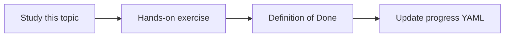

# Test datasets

Topic ID: `P6-T04` · Phase: `P6` · Track: `mvp` · Default owner: `developer-a`

## What is it?

Datasets include questions, gold answers, gold source IDs, and ACL context. They are versioned in git.

## Why do we need it?

Hidden private data must never be the eval set in this public-style repo.

## How does it work?

Use synthetic Atlas questions only. Split smoke vs full. Record dataset version in eval output.

## Example in our project

eval/v1/questions.yaml has 25 items covering all MVP sources.

The example uses the synthetic **Atlas Inventory Platform** only. Do not substitute real client systems.

## What must we learn?

- Dataset versioning
- Smoke vs full
- Synthetic only

## Hands-on exercise

Create v1 with at least 15 questions and gold source IDs.

**Deliverable:** Dataset layout under examples or eval/

## Definition of Done

Done is not “the Markdown file exists.” Done means you can explain the topic, you know why it matters for the agent, the exercise (or equivalent) is complete, and all of the following are true:

- v1 committed
- Gold source IDs present
- No real data

## Resources

Official documentation only. Expand this list as you study; do not add unverified links.

- [Vertex AI generative AI](https://cloud.google.com/vertex-ai/generative-ai/docs)

## Key Takeaways

- Version datasets
- Gold IDs, not vibes
- Synthetic forever in this repo

## Related Topics

- [P6-T05](../P6/P6-T05-golden-questions.md)
- [P6-T06](../P6/P6-T06-regression-testing.md)
