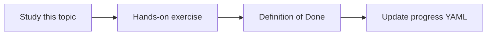

# Golden questions

Topic ID: `P6-T05` · Phase: `P6` · Track: `mvp` · Default owner: `developer-a`

## What is it?

Golden questions are product promises: architecture, rule location, meeting decision, data movement, unresolved questions.

## Why do we need it?

If these fail, the MVP is not a knowledge agent.

## How does it work?

Map each product example question to a synthetic gold item. Review monthly.

## Example in our project

Gold: “Where is reservation TTL set?” → ReservationService + reservation-v3.pdf.

The example uses the synthetic **Atlas Inventory Platform** only. Do not substitute real client systems.

## What must we learn?

- Product mapping
- Owner per question
- Review cadence

## Hands-on exercise

Write 10 golden questions mapped to the vision examples.

**Deliverable:** Golden question list covering example user questions

## Definition of Done

Done is not “the Markdown file exists.” Done means you can explain the topic, you know why it matters for the agent, the exercise (or equivalent) is complete, and all of the following are true:

- 10 golds exist
- Mapped to vision
- Owners assigned

## Resources

Official documentation only. Expand this list as you study; do not add unverified links.

- [Vertex AI generative AI](https://cloud.google.com/vertex-ai/generative-ai/docs)

## Key Takeaways

- Golds are product tests
- Map to user questions
- Review them

## Related Topics

- [P0-T01](../P0/P0-T01-ai-agent-product-vision.md)
- [P6-T06](../P6/P6-T06-regression-testing.md)
