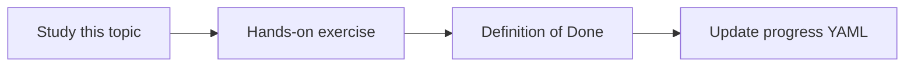

# Regression testing

Topic ID: `P6-T06` · Phase: `P6` · Track: `mvp` · Default owner: `developer-a`

## What is it?

Regression tests rerun smoke goldens on each PR using fixtures, not live paid APIs, unless a labeled job is used.

## Why do we need it?

A prompt tweak can break citations without failing unit tests.

## How does it work?

PR CI: deterministic fixture retriever + schema validation. Nightly: optional live model job.

## Example in our project

PR fails if structured output loses citations array or hit-rate@5 drops on fixtures.

The example uses the synthetic **Atlas Inventory Platform** only. Do not substitute real client systems.

## What must we learn?

- Fixture CI
- Nightly live (optional)
- Fail on citation schema

## Hands-on exercise

Add a unit test that rejects an uncited answer object.

**Deliverable:** CI smoke eval job design

## Definition of Done

Done is not “the Markdown file exists.” Done means you can explain the topic, you know why it matters for the agent, the exercise (or equivalent) is complete, and all of the following are true:

- CI path documented
- Fixture tests exist
- Live API not required on PRs

## Resources

Official documentation only. Expand this list as you study; do not add unverified links.

- [Google ADK](https://adk.dev/)

## Key Takeaways

- Fixtures on PRs
- Live models optional nightly
- Schema regressions are bugs

## Related Topics

- [P8-T02](../P8/P8-T02-ci-cd.md)
- [P1-T07](../P1/P1-T07-structured-outputs.md)
