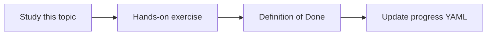

# Permission-aware retrieval

Topic ID: `P6-T07` · Phase: `P6` · Track: `mvp` · Default owner: `developer-a`

## What is it?

Retrieval must apply the user’s groups before generation. Prompt instructions are not an access-control layer.

## Why do we need it?

This is the highest-severity product risk.

## How does it work?

Pass user principal into the retriever. Test that denied chunks cannot appear in prompts.

## Example in our project

User group=engineering cannot see AIP-HR pages even if they ask in natural language.

The example uses the synthetic **Atlas Inventory Platform** only. Do not substitute real client systems.

## What must we learn?

- Principal in retriever
- Prompt is not ACL
- Negative tests

## Hands-on exercise

Write tests: denied chunk never in packed context.

**Deliverable:** ACL filter tests

## Definition of Done

Done is not “the Markdown file exists.” Done means you can explain the topic, you know why it matters for the agent, the exercise (or equivalent) is complete, and all of the following are true:

- Tests exist
- Filter is in code
- Prompt-only ACL rejected

## Resources

Official documentation only. Expand this list as you study; do not add unverified links.

- [Cloud IAM](https://cloud.google.com/iam/docs)

## Key Takeaways

- Enforce in retriever
- Negative tests required
- Prompts are not security

## Related Topics

- [P6-T08](../P6/P6-T08-least-privilege.md)
- [P6-T09](../P6/P6-T09-prompt-injection-defenses.md)
