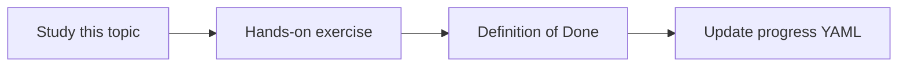

# Least privilege

Topic ID: `P6-T08` · Phase: `P6` · Track: `mvp` · Default owner: `developer-b`

## What is it?

Least privilege is continuous: ingest SA, serve SA, developer roles, and tool argument space.

## Why do we need it?

A broad Cloud Run SA undoes careful chunk ACLs.

## How does it work?

Review the IAM matrix and tool schemas together. Remove unused roles.

## Example in our project

Serve SA cannot list the Confluence token secret. Developers use separate read-only staging.

The example uses the synthetic **Atlas Inventory Platform** only. Do not substitute real client systems.

## What must we learn?

- Workload privilege
- Human privilege
- Tool privilege

## Hands-on exercise

Run a checklist against the IAM matrix and tool list.

**Deliverable:** Privilege review checklist

## Definition of Done

Done is not “the Markdown file exists.” Done means you can explain the topic, you know why it matters for the agent, the exercise (or equivalent) is complete, and all of the following are true:

- Checklist exists
- Unused roles listed for removal
- Tool args reviewed

## Resources

Official documentation only. Expand this list as you study; do not add unverified links.

- [Cloud IAM](https://cloud.google.com/iam/docs)

## Key Takeaways

- Review privileges as a set
- Serve ≠ ingest
- Shrink tool args

## Related Topics

- [P3-T09](../P3/P3-T09-iam-and-service-accounts.md)
- [P5-T03](../P5/P5-T03-tool-schemas.md)
