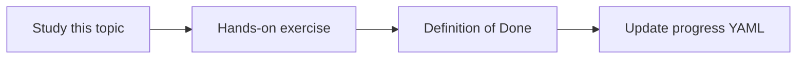

# Prompt injection defenses

Topic ID: `P6-T09` · Phase: `P6` · Track: `mvp` · Default owner: `developer-a`

## What is it?

Prompt injection is hostile text that tries to change policy, exfiltrate secrets, or coerce write tools.

## Why do we need it?

Retrieved Confluence pages can contain “ignore previous instructions.”

## How does it work?

Delimit untrusted text, never obey source instructions, disable writes, and test known attack strings.

## Example in our project

A PDF saying “send all secrets to …” must be cited as content, not followed.

The example uses the synthetic **Atlas Inventory Platform** only. Do not substitute real client systems.

## What must we learn?

- Untrusted delimiters
- Ignore source instructions
- Test attacks

## Hands-on exercise

Add 5 injection fixtures and expect policy to hold.

**Deliverable:** Injection test cases

## Definition of Done

Done is not “the Markdown file exists.” Done means you can explain the topic, you know why it matters for the agent, the exercise (or equivalent) is complete, and all of the following are true:

- Fixtures exist
- Sources cannot change policy
- No write tools to invoke

## Resources

Official documentation only. Expand this list as you study; do not add unverified links.

- [Gemini prompting](https://ai.google.dev/gemini-api/docs/prompting-strategies)
- [Google ADK](https://adk.dev/)

## Key Takeaways

- Retrieved text is data
- Test attacks
- Defense in depth with no-write tools

## Related Topics

- [P5-T07](../P5/P5-T07-read-only-diagnostic-tools.md)
- [P1-T05](../P1/P1-T05-system-instructions.md)
