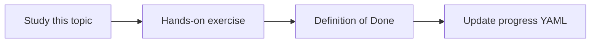

# Secrets and PII protection

Topic ID: `P6-T10` · Phase: `P6` · Track: `mvp` · Default owner: `developer-b`

## What is it?

API keys, tokens, and personal data need detection and exclusion. Indexes of customer PII are out of scope.

## Why do we need it?

Once PII is embedded, deletion is harder than never ingesting it.

## How does it work?

Pre-ingest scanners for key patterns. Drop or redact. Forbid customer-data sources in MVP.

## Example in our project

A Git file accidentally containing a fake API key in synthetic tests should be flagged by the scanner.

The example uses the synthetic **Atlas Inventory Platform** only. Do not substitute real client systems.

## What must we learn?

- Pre-ingest scan
- PII classes
- Index exclusion

## Hands-on exercise

Document PII classes and add a regex scan for token-like strings in fixtures.

**Deliverable:** Redaction rules

## Definition of Done

Done is not “the Markdown file exists.” Done means you can explain the topic, you know why it matters for the agent, the exercise (or equivalent) is complete, and all of the following are true:

- Rules written
- Token scan exists or is specified
- Customer PII out of scope

## Resources

Official documentation only. Expand this list as you study; do not add unverified links.

- [Secret Manager](https://cloud.google.com/secret-manager/docs)

## Key Takeaways

- Don’t embed PII
- Scan before index
- Secrets never in prompts

## Related Topics

- [P3-T10](../P3/P3-T10-secret-manager.md)
- [P6-T12](../P6/P6-T12-data-retention.md)
