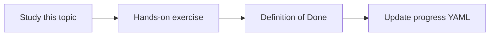

# Audit logging

Topic ID: `P6-T11` · Phase: `P6` · Track: `mvp` · Default owner: `developer-b`

## What is it?

Audit logs support incident response and access reviews. They store metadata, not necessarily full prompt text.

## Why do we need it?

Without audit, ACL bugs cannot be investigated.

## How does it work?

Log principal, timestamp, question hash, source IDs returned, deny decisions. Control access to audit logs.

## Example in our project

Event: user=dev-a, sources=[git:…, pdf:…], denied_sources_count=2.

The example uses the synthetic **Atlas Inventory Platform** only. Do not substitute real client systems.

## What must we learn?

- Audit vs debug logs
- Question hashing
- Retention separate

## Hands-on exercise

Write the audit schema and who can read it.

**Deliverable:** Audit event schema

## Definition of Done

Done is not “the Markdown file exists.” Done means you can explain the topic, you know why it matters for the agent, the exercise (or equivalent) is complete, and all of the following are true:

- Schema exists
- Debug vs audit split
- Access to audit restricted

## Resources

Official documentation only. Expand this list as you study; do not add unverified links.

- [Cloud Logging](https://cloud.google.com/logging/docs)
- [Cloud IAM](https://cloud.google.com/iam/docs)

## Key Takeaways

- Audit who/what/which sources
- Hash questions if needed
- Restrict audit access

## Related Topics

- [P6-T12](../P6/P6-T12-data-retention.md)
- [P8-T05](../P8/P8-T05-monitoring.md)
