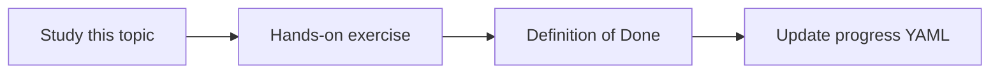

# Data retention

Topic ID: `P6-T12` · Phase: `P6` · Track: `mvp` · Default owner: `developer-b`

## What is it?

Retention differs by class: raw docs, indexes, debug logs, audit logs, transcripts.

## Why do we need it?

Transcripts often have shorter legal retention than architecture PDFs.

## How does it work?

Write a table: data class, TTL, owner, deletion method. Align with source system where required.

## Example in our project

Transcripts 90 days; architecture PDFs until source deletes; debug logs 30 days; audit 1 year (example policy).

The example uses the synthetic **Atlas Inventory Platform** only. Do not substitute real client systems.

## What must we learn?

- Per-class TTL
- Deletion method
- Source-aligned

## Hands-on exercise

Fill the retention table with example (non-legal-advice) values and mark legal review needed.

**Deliverable:** Retention table

## Definition of Done

Done is not “the Markdown file exists.” Done means you can explain the topic, you know why it matters for the agent, the exercise (or equivalent) is complete, and all of the following are true:

- Table exists
- Legal review flagged
- Transcripts shorter than PDFs

## Resources

Official documentation only. Expand this list as you study; do not add unverified links.

- [Cloud Storage](https://cloud.google.com/storage/docs)

## Key Takeaways

- Class-based TTL
- Deletion is a pipeline
- Not legal advice—review later

## Related Topics

- [P4-T18](../P4/P4-T18-deletion-propagation.md)
- [P8-T07](../P8/P8-T07-operational-runbooks.md)
