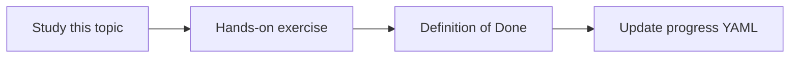

# Human approval for risky actions

Topic ID: `P6-T13` · Phase: `P6` · Track: `mvp` · Default owner: `developer-a`

## What is it?

Risky actions include SQL beyond templates, sending messages, or changing tickets. MVP has none enabled.

## Why do we need it?

When someone adds a write tool, the approval story must already exist.

## How does it work?

Define approver role, what is blocked, and an audit record of approvals.

## Example in our project

“Run this SELECT” on a new table requires Developer B approval in staging; production forbids it.

The example uses the synthetic **Atlas Inventory Platform** only. Do not substitute real client systems.

## What must we learn?

- Allowlist vs approval
- Approver role
- Audit of approvals

## Hands-on exercise

Write the policy stating MVP enables zero risky actions.

**Deliverable:** Approval policy

## Definition of Done

Done is not “the Markdown file exists.” Done means you can explain the topic, you know why it matters for the agent, the exercise (or equivalent) is complete, and all of the following are true:

- Policy exists
- MVP risky action count is 0
- Future gate described

## Resources

Official documentation only. Expand this list as you study; do not add unverified links.

- [Cloud IAM](https://cloud.google.com/iam/docs)

## Key Takeaways

- Default block
- Approvals audited
- Don’t add writes casually

## Related Topics

- [P4-T10](../P4/P4-T10-safe-read-only-sql-access.md)
- [P8-T07](../P8/P8-T07-operational-runbooks.md)
