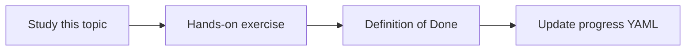

# Cost and latency measurement

Topic ID: `P6-T14` · Phase: `P6` · Track: `mvp` · Default owner: `developer-a`

## What is it?

Each /ask should record model tokens, embedding tokens, tool latency, and estimated USD if rates are configured.

## Why do we need it?

Unmeasured agents surprise finance and users.

## How does it work?

Dashboards can wait; log fields cannot. Set a latency SLO as a target, not a lie.

## Example in our project

p95 6s local fixture; live Gemini p95 tracked nightly.

The example uses the synthetic **Atlas Inventory Platform** only. Do not substitute real client systems.

## What must we learn?

- Token fields
- p95
- Estimated cost

## Hands-on exercise

Add timing around the skeleton /ask path even if the LLM is mocked.

**Deliverable:** Per-request cost/latency log fields

## Definition of Done

Done is not “the Markdown file exists.” Done means you can explain the topic, you know why it matters for the agent, the exercise (or equivalent) is complete, and all of the following are true:

- Fields defined
- Mock timing works
- SLO is labeled target

## Resources

Official documentation only. Expand this list as you study; do not add unverified links.

- [Vertex AI generative AI](https://cloud.google.com/vertex-ai/generative-ai/docs)
- [Cloud Run docs](https://cloud.google.com/run/docs)

## Key Takeaways

- Log cost drivers
- Label SLOs honestly
- Nightly live optional

## Related Topics

- [P8-T05](../P8/P8-T05-monitoring.md)
- [P8-T06](../P8/P8-T06-cost-controls.md)
