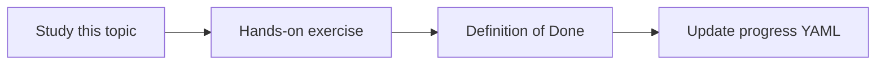

# Failure recovery

Topic ID: `P6-T15` · Phase: `P6` · Track: `mvp` · Default owner: `developer-b`

## What is it?

Recovery includes retries, serving last-good index, and answering “degraded” when a connector is down.

## Why do we need it?

A Schema Registry outage should not blank the entire agent if Git docs still work.

## How does it work?

Matrix: dependency, failure, user impact, operator action.

## Example in our project

Index build fails → keep previous snapshot. Gemini down → return 503 with request_id.

The example uses the synthetic **Atlas Inventory Platform** only. Do not substitute real client systems.

## What must we learn?

- Last-good index
- Partial capability
- Operator actions

## Hands-on exercise

Write the degradation matrix for model, index, and one connector.

**Deliverable:** Degradation matrix

## Definition of Done

Done is not “the Markdown file exists.” Done means you can explain the topic, you know why it matters for the agent, the exercise (or equivalent) is complete, and all of the following are true:

- Matrix exists
- Last-good index referenced
- User-visible degraded mode defined

## Resources

Official documentation only. Expand this list as you study; do not add unverified links.

- [Cloud Run docs](https://cloud.google.com/run/docs)
- [Cloud Logging](https://cloud.google.com/logging/docs)

## Key Takeaways

- Fail partial, not silent
- Keep last-good index
- Tell the user

## Related Topics

- [P8-T09](../P8/P8-T09-connector-health-monitoring.md)
- [P8-T10](../P8/P8-T10-deployment-and-rollback.md)
