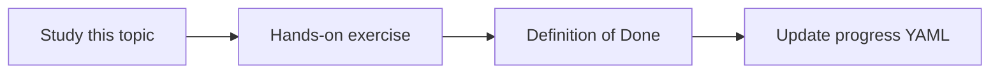

# Meeting transcript intelligence

Topic ID: `P7-T01` · Phase: `P7` · Track: `advanced` · Default owner: `developer-a`

## What is it?

Transcript intelligence preserves speakers, timestamps, and meeting metadata in chunks and citations.

## Why do we need it?

“What did we decide?” is otherwise an unsearchable wall of text.

## How does it work?

Chunk by topic or time window, keep speaker labels, cite meeting id + timestamp.

## Example in our project

[00:12:04] Jordan: “TTL stays 15 minutes.” cites meeting 2026-03-12.

The example uses the synthetic **Atlas Inventory Platform** only. Do not substitute real client systems.

## What must we learn?

- Speaker labels
- Time citations
- Meeting metadata

## Hands-on exercise

Chunk a synthetic transcript and retrieve a decision by speaker.

**Deliverable:** Transcript chunking with speakers and times

## Definition of Done

Done is not “the Markdown file exists.” Done means you can explain the topic, you know why it matters for the agent, the exercise (or equivalent) is complete, and all of the following are true:

- Speaker+time on chunks
- Citation includes timestamp
- Fixture committed

## Resources

Official documentation only. Expand this list as you study; do not add unverified links.

- [Graph onlineMeeting](https://learn.microsoft.com/en-us/graph/api/resources/onlinemeeting?view=graph-rest-1.0)

## Key Takeaways

- Attribution is mandatory
- Time is the locator
- Meetings are first-class sources

## Related Topics

- [P7-T02](../P7/P7-T02-decision-extraction.md)
- [P4-T14](../P4/P4-T14-microsoft-graph-and-teams-transcripts.md)
