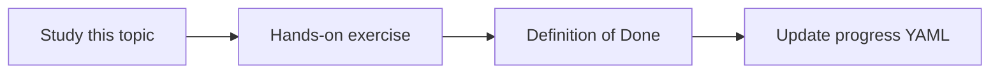

# Decision extraction

Topic ID: `P7-T02` · Phase: `P7` · Track: `advanced` · Default owner: `developer-a`

## What is it?

A decision record has statement, status, date, sources, and owners. Extraction is model-assisted and human-confirmable.

## Why do we need it?

Unstructured meetings hide the architecture of record.

## How does it work?

Propose decisions with evidence spans. Do not mark confirmed without a rule (human or explicit “we decided”).

## Example in our project

Decision: reservation TTL=15m; status=proposed; evidence=transcript 00:12:04 + later ADR.

The example uses the synthetic **Atlas Inventory Platform** only. Do not substitute real client systems.

## What must we learn?

- Evidence spans
- Proposed vs confirmed
- Owners

## Hands-on exercise

Extract decisions from one synthetic transcript and one ADR.

**Deliverable:** Decision records from a synthetic meeting

## Definition of Done

Done is not “the Markdown file exists.” Done means you can explain the topic, you know why it matters for the agent, the exercise (or equivalent) is complete, and all of the following are true:

- Schema exists
- Evidence required
- Status not always confirmed

## Resources

Official documentation only. Expand this list as you study; do not add unverified links.

- [Vertex AI generative AI](https://cloud.google.com/vertex-ai/generative-ai/docs)

## Key Takeaways

- No evidence, no decision
- Status is a field
- Humans may confirm later

## Related Topics

- [P7-T03](../P7/P7-T03-decision-status-and-provenance.md)
- [P7-T09](../P7/P7-T09-contradiction-detection.md)
