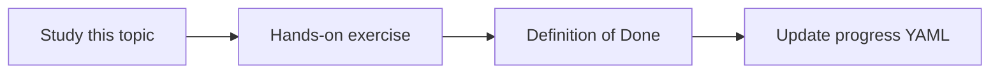

# Decision status and provenance

Topic ID: `P7-T03` · Phase: `P7` · Track: `advanced` · Default owner: `developer-a`

## What is it?

Status and provenance say who decided, where, and whether it still holds.

## Why do we need it?

Citing a rejected option as current architecture is a high-severity miss.

## How does it work?

Store status, decided_in, superseded_by, and provenance chain.

## Example in our project

TTL=30m rejected in ADR 0012; TTL=15m accepted in ADR 0014.

The example uses the synthetic **Atlas Inventory Platform** only. Do not substitute real client systems.

## What must we learn?

- Status enum
- Provenance chain
- Who decided

## Hands-on exercise

Model two competing TTL decisions with statuses.

**Deliverable:** Status model

## Definition of Done

Done is not “the Markdown file exists.” Done means you can explain the topic, you know why it matters for the agent, the exercise (or equivalent) is complete, and all of the following are true:

- Enum defined
- Chain demo exists
- Agent must surface status

## Resources

Official documentation only. Expand this list as you study; do not add unverified links.

- [Vertex AI generative AI](https://cloud.google.com/vertex-ai/generative-ai/docs)

## Key Takeaways

- Always show status
- Provenance is a chain
- Rejected ≠ missing

## Related Topics

- [P7-T10](../P7/P7-T10-temporal-knowledge-and-superseded-decisions.md)
- [P7-T09](../P7/P7-T09-contradiction-detection.md)
