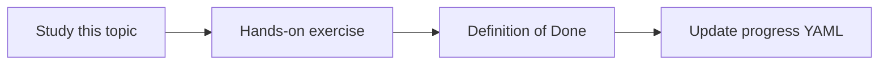

# Cross-meeting comparison

Topic ID: `P7-T04` · Phase: `P7` · Track: `advanced` · Default owner: `developer-a`

## What is it?

Comparison aligns mentions of the same entity across transcripts and docs.

## Why do we need it?

Teams reverse themselves; the agent should show the timeline, not a random meeting.

## How does it work?

Cluster by topic key (e.g., reservation.ttl) and order by date.

## Example in our project

Mar 12 propose 15m; Mar 19 challenge 30m; Mar 22 ADR 0014 accepts 15m.

The example uses the synthetic **Atlas Inventory Platform** only. Do not substitute real client systems.

## What must we learn?

- Topic keys
- Timelines
- Contradiction candidates

## Hands-on exercise

Build a timeline from three synthetic meetings plus one ADR.

**Deliverable:** Timeline for one decision topic

## Definition of Done

Done is not “the Markdown file exists.” Done means you can explain the topic, you know why it matters for the agent, the exercise (or equivalent) is complete, and all of the following are true:

- Timeline demo
- Topic key defined
- Dates visible

## Resources

Official documentation only. Expand this list as you study; do not add unverified links.

- [Graph onlineMeeting](https://learn.microsoft.com/en-us/graph/api/resources/onlinemeeting?view=graph-rest-1.0)

## Key Takeaways

- Time order matters
- Same topic key
- Don’t flatten history

## Related Topics

- [P7-T09](../P7/P7-T09-contradiction-detection.md)
- [P7-T10](../P7/P7-T10-temporal-knowledge-and-superseded-decisions.md)
