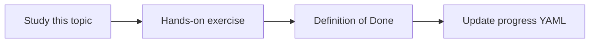

# Requirements traceability

Topic ID: `P7-T05` · Phase: `P7` · Track: `advanced` · Default owner: `developer-a`

## What is it?

Traceability maps requirement IDs to design sections, classes, and tests. The agent reports missing links as gaps, not as facts.

## Why do we need it?

Impact analysis depends on these links.

## How does it work?

Use explicit IDs in synthetic docs. Do not invent traces. Show coverage gaps.

## Example in our project

REQ-12 reservation TTL → design v3 §4 → ReservationService → missing test noted.

The example uses the synthetic **Atlas Inventory Platform** only. Do not substitute real client systems.

## What must we learn?

- REQ IDs
- Gap reporting
- No invented links

## Hands-on exercise

Create a matrix for two requirements with one intentional gap.

**Deliverable:** Trace matrix for synthetic REQ-12

## Definition of Done

Done is not “the Markdown file exists.” Done means you can explain the topic, you know why it matters for the agent, the exercise (or equivalent) is complete, and all of the following are true:

- Matrix exists
- Gaps visible
- No hallucinated links

## Resources

Official documentation only. Expand this list as you study; do not add unverified links.

- [Vertex AI generative AI](https://cloud.google.com/vertex-ai/generative-ai/docs)

## Key Takeaways

- IDs make tracing possible
- Gaps are answers
- Don’t invent traces

## Related Topics

- [P7-T06](../P7/P7-T06-code-to-requirement-mapping.md)
- [P7-T08](../P7/P7-T08-change-impact-analysis.md)
