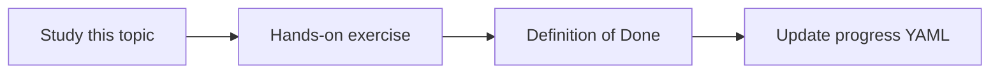

# Code-to-requirement mapping

Topic ID: `P7-T06` · Phase: `P7` · Track: `advanced` · Default owner: `developer-a`

## What is it?

Mapping uses comments, annotations, or co-retrieval of design+code, always with evidence.

## Why do we need it?

“Which requirement does this class implement?” is a change-management question.

## How does it work?

Prefer explicit annotations in synthetic code. Fall back to cited co-occurrence, marked low confidence.

## Example in our project

ReservationService.java comment `implements REQ-12` is high confidence.

The example uses the synthetic **Atlas Inventory Platform** only. Do not substitute real client systems.

## What must we learn?

- Explicit vs inferred
- Confidence
- Evidence

## Hands-on exercise

Map two classes, one explicit and one inferred with low confidence.

**Deliverable:** Symbol-to-REQ index for synthetic code

## Definition of Done

Done is not “the Markdown file exists.” Done means you can explain the topic, you know why it matters for the agent, the exercise (or equivalent) is complete, and all of the following are true:

- Explicit path works
- Inferred marked low confidence
- Evidence stored

## Resources

Official documentation only. Expand this list as you study; do not add unverified links.

- [Git documentation](https://git-scm.com/docs)

## Key Takeaways

- Prefer explicit links
- Inferred is low confidence
- Always show evidence

## Related Topics

- [P4-T08](../P4/P4-T08-java-code-indexing.md)
- [P7-T08](../P7/P7-T08-change-impact-analysis.md)
