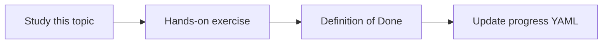

# Architecture dependency analysis

Topic ID: `P7-T07` · Phase: `P7` · Track: `advanced` · Default owner: `developer-a`

## What is it?

Dependencies include package calls, REST clients, and Kafka produce/consume relationships.

## Why do we need it?

Impact questions need a graph, even a small one.

## How does it work?

Build a coarse graph from synthetic annotations and OpenAPI/Kafka catalogs. Don’t claim completeness.

## Example in our project

inventory-service produces inventory.reserved; order-service consumes it; both write reservation table.

The example uses the synthetic **Atlas Inventory Platform** only. Do not substitute real client systems.

## What must we learn?

- Coarse graphs
- Multiple edge types
- Completeness caveats

## Hands-on exercise

Draw a graph with at least three node types (service, topic, table).

**Deliverable:** Dependency sketch for Atlas inventory

## Definition of Done

Done is not “the Markdown file exists.” Done means you can explain the topic, you know why it matters for the agent, the exercise (or equivalent) is complete, and all of the following are true:

- Graph exists
- Caveat documented
- Sources cited on edges if possible

## Resources

Official documentation only. Expand this list as you study; do not add unverified links.

- [Apache Kafka docs](https://kafka.apache.org/documentation/)

## Key Takeaways

- Coarse is useful
- Cite edges
- Say what’s missing

## Related Topics

- [P7-T08](../P7/P7-T08-change-impact-analysis.md)
- [P5-T13](../P5/P5-T13-cross-source-question-answering.md)
