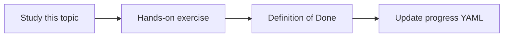

# Change-impact analysis

Topic ID: `P7-T08` · Phase: `P7` · Track: `advanced` · Default owner: `developer-a`

## What is it?

Impact analysis combines the dependency graph, traces, and recent decisions to list likely touched components.

## Why do we need it?

This is a flagship advanced question in the vision.

## How does it work?

Return impacted services, tables, topics, docs, and open questions, each cited, with confidence.

## Example in our project

Changing TTL likely touches ReservationService, reservation.ttl_minutes, inventory.reserved schema, and design v3.

The example uses the synthetic **Atlas Inventory Platform** only. Do not substitute real client systems.

## What must we learn?

- Impact lists
- Confidence
- Open questions

## Hands-on exercise

Write one impact report from synthetic graph + docs.

**Deliverable:** Impact answer for a synthetic TTL change

## Definition of Done

Done is not “the Markdown file exists.” Done means you can explain the topic, you know why it matters for the agent, the exercise (or equivalent) is complete, and all of the following are true:

- Report includes multiple node types
- Citations present
- Uncertainty listed

## Resources

Official documentation only. Expand this list as you study; do not add unverified links.

- [Vertex AI generative AI](https://cloud.google.com/vertex-ai/generative-ai/docs)

## Key Takeaways

- Impact is a list plus gaps
- Cite each item
- Don’t pretend completeness

## Related Topics

- [P0-T01](../P0/P0-T01-ai-agent-product-vision.md)
- [P7-T09](../P7/P7-T09-contradiction-detection.md)
